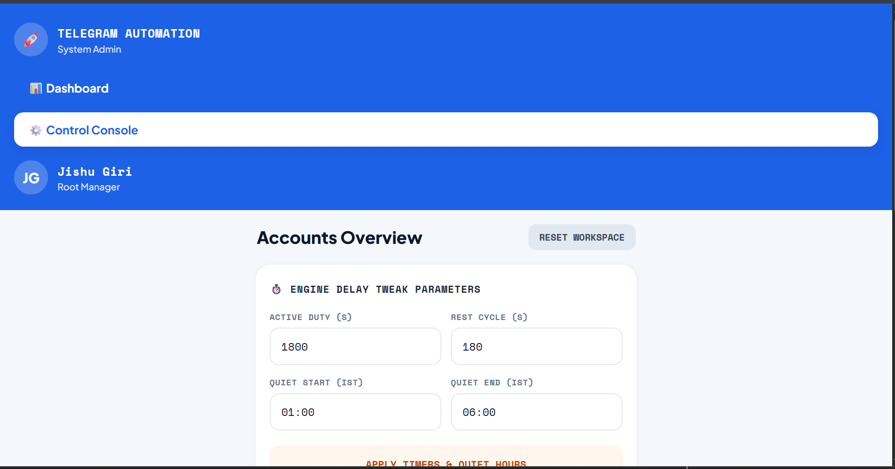
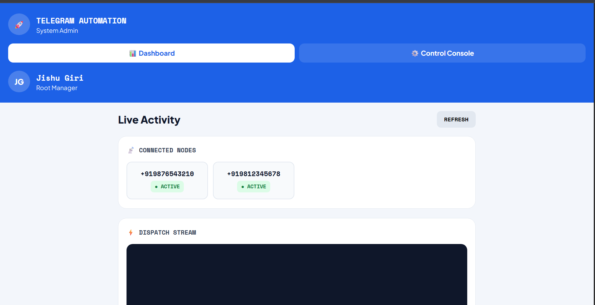

# 🚀 Telegram Automation Engine & Cloud Console

A resilient, scalable Telegram broadcast and rotation control platform built with **FastAPI**, **Telethon**, and **Cloudflare Tunnels**. Engineered to manage multi-account sessions, enforce duty-cycle delays, and bypass Telegram rate limits seamlessly.

---

## 🚀 Live Demo

- 🌐 **Live Web Console:** [Open Control Console](https://cited-series-distributors-ships.trycloudflare.com/control)
- 📊 **Live Activity Feed:** [Open Live Dashboard](https://cited-series-distributors-ships.trycloudflare.com/dashboard)

> **Authentication Credentials:**
> - **Username:** \vijit\
> - **Password:** \721517\

---

## 📸 Project Preview

### ⚙️ Mobile & Web Control Console
*Interactive management panel featuring engine delay parameters, OTP session onboarding, and active system node controls (Mute / Drop).*

  

### 📊 Real-Time Dispatch Terminal
*Live monitoring telemetry capturing broadcast logs, target groups, reference IDs, and execution states.*

  

---

## ⚡ Core Features

- **Dynamic Account Rotation:** Manages pooled Telegram user sessions with individual active/idle duty timers.
- **IST Quiet Hours Scheduler:** Automatic suspension of outreach scripts during off-peak Indian Standard Time (IST) periods to prevent spam detection.
- **Cloudflare Edge Exposure:** Integrated zero-trust tunnel architecture (\cloudflared\) allowing remote secure dashboard management without opening inbound router ports.
- **Live Dispatch Stream:** Real-time logging terminal tracking phone numbers, target groups, reference IDs, and dispatch status.
- **Mobile-Responsive Control Console:** Tailored card layout for rapid session onboarding and runtime monitoring across desktop and mobile screens.

---

## 🛠️ Tech Stack

- **Backend:** Python 3.10+, FastAPI, Uvicorn
- **Telegram Client:** Telethon (MTProto API)
- **Database:** MySQL / MariaDB via PyMySQL
- **Tunneling & Edge:** Cloudflare Tunnel (\cloudflared\)
- **Frontend:** Jinja2 Templates, HTML5/CSS3 (Space Mono & Plus Jakarta Sans)

---

## 🚀 Quickstart Guide

### 1. Clone & Setup Virtual Environment
\\\ash
git clone https://github.com/jishugiri/tg-automation.git
cd tg-automation
python -m venv venv
.\venv\Scripts\activate   # On Linux: source venv/bin/activate
pip install -r requirements.txt
\\\

### 2. Run Application Server
\\\ash
python -m uvicorn main:app --host 127.0.0.1 --port 8000
\\\

### 3. Expose Secure Public Tunnel
\\\ash
.\cloudflared.exe tunnel --url http://127.0.0.1:8000
\\\

---

## 👤 Maintainer

- **Developer:** Jishu Giri
- **Role:** Root Manager / System Admin

